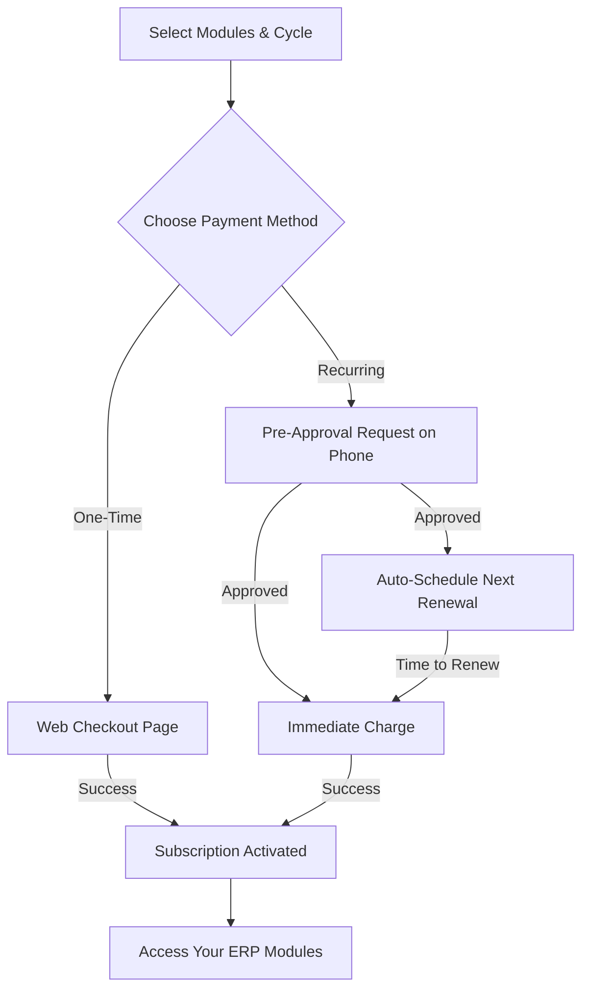

# Rhyolite ERP Subscription Guide

Welcome to Rhyolite ERP! This guide explains how to subscribe to our modules and how our payment system works to keep your business running smoothly.

## 1. Choose Your Modules
Rhyolite ERP is modular, meaning you only pay for what you use. You can select one or more modules such as:
*   **General Ledger (GL)**: Manage your finances.
*   **Payroll**: Handle employee salaries and taxes.
*   **School Manager**: Manage student records and fees.
*   **Accounts Payable/Receivable**: Track what you owe and what is owed to you.
*   **And more...**

## 2. Select Your Billing Cycle
Choose how often you want to be billed:
*   **Quarterly**: Every 3 months.
*   **Half-Yearly**: Every 6 months.
*   **Annual**: Once a year.

## 3. Choose Your Payment Method
We offer two ways to pay:

### Option A: One-Time Payment (Web Checkout)
1.  You select your modules and click "Pay Now".
2.  You are redirected to a secure Hubtel payment page.
3.  Pay using Mobile Money or Card.
4.  Once successful, your subscription is activated immediately.
5.  **Note**: You will need to manually pay again when your subscription expires.

### Option B: Automated Recurring Payment (Recommended)
1.  **Pre-Approval**: You authorize Rhyolite ERP to automatically debit your account for future renewals.
2.  **Immediate Activation**: We perform the first charge immediately after you approve the pre-approval request on your phone.
3.  **Hassle-Free Renewals**: Before your current subscription expires, our system (powered by Quartz) will automatically schedule a charge for the next period.
4.  **Stay Informed**: You will receive notifications for every successful transaction.

## 4. How the Process Works (Visual)

## 5. Managing Your Subscription
You can always view your payment history and current subscription status in the **Module Manager** section of your account. If you ever need to change your modules or cancel a recurring payment, our support team is here to help!

---
*Thank you for choosing Rhyolite ERP!*
